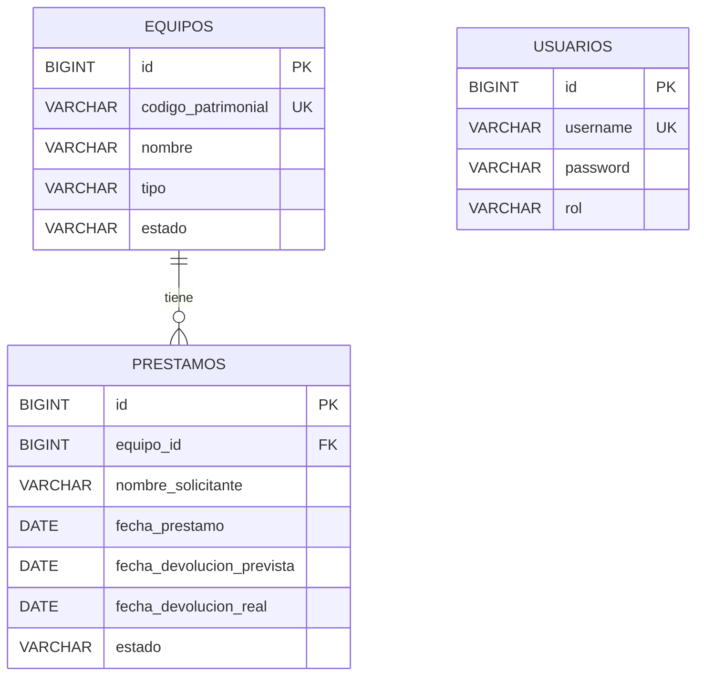

# Modelo entidad-relación

## Relación Equipo – Prestamo (1:N)

- Un **equipo** puede tener **muchos préstamos** a lo largo del tiempo (historial), pero solo uno `ACTIVO` a la vez (regla que valida el servicio).
- `Prestamo` es el **lado dueño** de la relación: tiene `@ManyToOne` y la llave foránea `equipo_id`.
- `Equipo` tiene el lado inverso `@OneToMany(mappedBy = "equipo")`; `mappedBy` evita que JPA cree una segunda FK o una tabla intermedia.
- `FetchType.LAZY` en `Prestamo.equipo`: el equipo se carga solo cuando se usa.

## ¿Por qué `CascadeType.REMOVE`?

La regla de negocio prohíbe eliminar un equipo con préstamos **activos** (el servicio responde 409). Si el equipo solo tiene préstamos **devueltos**, se permite eliminarlo; sin cascada la FK `equipo_id` lo impediría. Con `CascadeType.REMOVE`, al borrar el equipo se borra también su historial de préstamos devueltos.

## Enums

Se guardan como texto (`@Enumerated(EnumType.STRING)`), así la tabla es legible y reordenar un enum no corrompe los datos.

| Enum | Valores |
|---|---|
| `TipoEquipo` | LAPTOP, PROYECTOR, TABLETA |
| `EstadoEquipo` | DISPONIBLE, PRESTADO |
| `EstadoPrestamo` | ACTIVO, DEVUELTO |
| `Rol` | USER, ADMIN |

## Usuarios

`usuarios.password` guarda el hash **BCrypt**, nunca la contraseña en texto plano. Las cuentas de prueba las crea la aplicación al arrancar.
